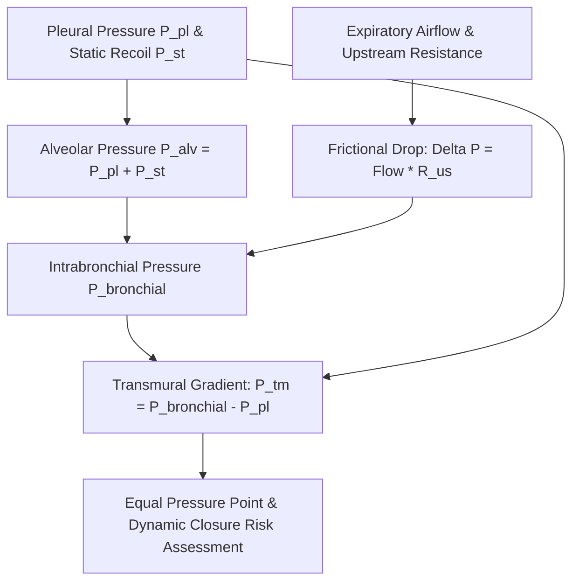

# Pulmonary Dynamic Airway Closing Pressure Skill

[](LICENSE)
[](https://www.python.org/)
[](https://openclaw.org/)
[](https://alphapark.ai/)
[](https://modelcontextprotocol.io/)

Dynamic Airway Closing Pressure ($P_{\text{cl}}$) and Static Recoil Pressure ($P_{\text{st}(L)}$) Analyzer based on Mead's Equal Pressure Point (EPP) physiological formulation.



## Features
- **Zero PIP Dependencies**: Implemented strictly with Python Standard Library (`math`, `json`, `sys`, `typing`).
- **Mead's EPP Physics**: Models the transition from effort-dependent to effort-independent flow limitation.
- **Dynamic Collapse Prevention**: Identifies premature peripheral airway closure and gas trapping.
- **Dual Architecture**: Native Python import and Model Context Protocol (MCP) JSON-RPC 2.0 stdio server.

## Quickstart
```bash
python example_usage.py
```

## License
Apache-2.0
